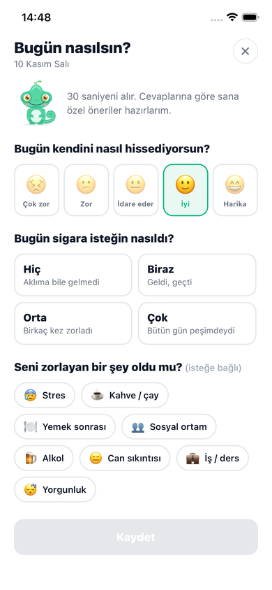
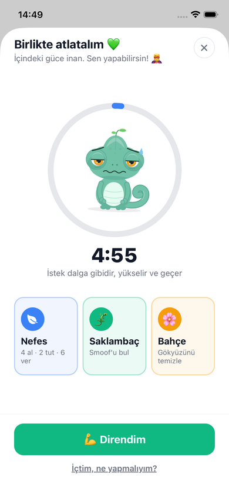
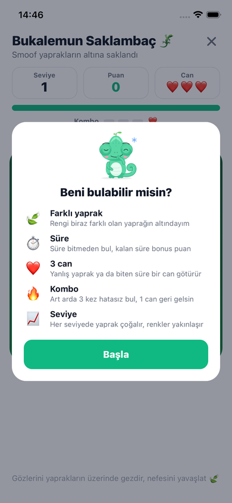
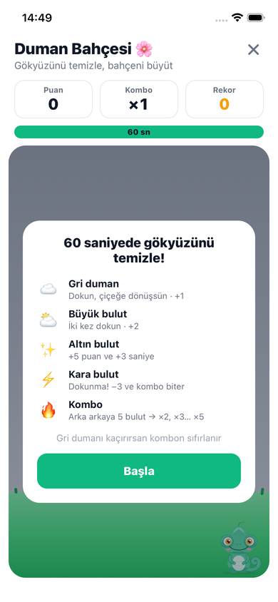

<div align="center">


# Smoof

**Sigarayı bırakma yolculuğunda yanında olan, seni tanıyan bir arkadaş.**

Hemen bırakmak ya da adım adım azaltmak isteyenler için Türkçe bir mobil uygulama.<br/>
Smoof adında sevimli bir bukalemun; isteğin geldiği anda yanında, iyi gününde seninle sevinir, zor gününde destek olur.


</div>

<p align="center">
  
  
  
  
  
</p>

---

## İçindekiler

- [Özellikler](#özellikler)
- [Öne çıkan detaylar](#öne-çıkan-detaylar)
- [Teknolojiler](#teknolojiler)
- [Başlarken](#başlarken)
- [Proje yapısı](#proje-yapısı)
- [Mimari notlar](#mimari-notlar)
- [Geliştirici test modu](#geliştirici-test-modu)
- [Gizlilik](#gizlilik)
- [Yol haritası](#yol-haritası)

## Özellikler

### İki yöntem, tek uygulama
- **Hemen bırak:** Sigarasız süre, sağlık kazanımları zaman çizelgesi, tasarruf ve içilmeyen sigara sayacı.
- **Kademeli azalt:** 4, 6, 8 ya da 12 haftalık plan. Günlük limit her hafta eşit şekilde düşer ve seçilen sürenin sonunda sıfıra iner.
- **Yöntem ve plan değiştirilebilir:** Plan hızlı ya da yavaş gelirse süre değişir, istenirse yöntem değişir. Geçmiş günlerin limitleri ve girişler hiç değişmez.
- **Yol haritası:** Hangi hafta günde kaç sigara içilebileceği ve ilk sigarasız günün tarihi.

### Zor anlarda destek
- **"Canın sigara mı çekti?"** ekranı: istek dalgası geçene kadar sayan bir zamanlayıcı, rehberli nefes egzersizi (4 al · 2 tut · 6 ver) ve iki mini oyun.
- **Bukalemun Saklambaç:** Smoof'un saklandığı, rengi biraz farklı yaprağı bul. Can, süre, kombo ve giderek zorlaşan seviyeler.
- **Duman Bahçesi:** 60 saniyede gökyüzünü temizle. Farklı bulut türleri, kombo çarpanı ve rekor.
- **Kayma akışı:** Kayma olursa yargılamadan tetikleyiciyi sorar, streak freeze ile seriyi koruma seçeneği sunar.

### Seni tanıyan Smoof
- **Günlük check-in:** Ruh hali, sigara isteği ve zorlayan şeyler, 30 saniyede. Smoof cevaplara ve yönteme göre en fazla iki kişisel öneri verir.
- **Zor anlardan önce destek:** Kriz kayıtlarından en zor saatleri ve günü öğrenir, o anlardan hemen önce kısa bir destek mesajı gönderir.
- **Plan önerileri:** Zorlanıyorsan planı yavaşlatmayı, çok iyi gidiyorsan hızlandırmayı ya da tamamen bırakmayı önerir.
- **Haftalık özet ve keşifler:** Haftanın ruh hali, en çok zorlayan şey, gelecek haftanın hedefi; yeterli veri birikince "Kahve olan günlerde isteğin iki katına çıkıyor" gibi kişisel keşifler.

### Takip ve motivasyon
- Takvim üzerinden günlük giriş, eksik günleri sırayla doldurma akışı.
- Disiplin ve sigarasız gün serileri. Girilmemiş günler seriyi ne bozar ne de şişirir.
- 30'dan fazla rozet: seri, sağlık, tasarruf, direnç, kademeli ve farkındalık.
- Kişiselleştirilebilir Smoof: renk, göz, saç, bıyık, gözlük.
- Açık / koyu tema, akıllı ve sınırlı bildirimler.

## Öne çıkan detaylar

Uygulamanın arkasındaki bazı hesapların nasıl çalıştığı:

| Konu | Yaklaşım |
|---|---|
| Kademeli plan | Limit, ilk hafta hedefinden sıfıra doğrusal iner ve yukarı yuvarlanır. Böylece son haftaya kadar en az 1 kalır ve limit hiçbir gün artmaz. Hedef düşürme ve süre değiştirme, değişiklik gününden itibaren yeni bir plan parçası olarak eklenir; geçmiş günlerin limiti korunur. |
| Seriler | Kaydı olmayan geçmiş gün, kendinden sonraki günleri "beklemede" tutar. Boşluk doldurulunca hepsi birlikte sayılır, hedef aşılmışsa seri orada biter. |
| Öğrenen bildirimler | Son 4 haftada aynı saatte en az 3 kriz kaydı gerekir. Veri yetersizse genel saatler kullanılır. |
| Keşifler | En az 14 check-in ve her iki grupta en az 3 gün olmadan gösterilmez. Az veriden tahmin yapılmaz. |
| Bildirim yükü | Check-in hatırlatıcısı sadece o gün doldurulmadıysa gelir. Bildirim izni kullanıcı istemeden sorulmaz. |

## Teknolojiler

| Alan | Kullanılan |
|---|---|
| Uygulama | [Expo SDK 58](https://docs.expo.dev/), React Native 0.88, React 19 |
| Dil | TypeScript |
| Navigasyon | [Expo Router](https://docs.expo.dev/router/introduction/) (dosya tabanlı) |
| Durum yönetimi | [Zustand](https://github.com/pmndrs/zustand) |
| Kalıcı veri | AsyncStorage (sadece cihazda) |
| Bildirimler | expo-notifications (yerel bildirimler) |
| Grafik ve animasyon | react-native-svg (maskot ve grafikler), React Native Animated, expo-linear-gradient |

## Başlarken

### Gereksinimler
- Node.js 20 veya üzeri
- Telefonda [Expo Go](https://expo.dev/go) ya da iOS Simulator / Android Emulator

### Kurulum

```bash
git clone https://github.com/erolsptr/smoof.git
cd smoof
npm install
npx expo start
```

Terminalde çıkan QR kodu telefondaki Expo Go ile okut. Simülatörde açmak için `i` (iOS) ya da `a` (Android) tuşuna bas.

### Komutlar

| Komut | Açıklama |
|---|---|
| `npm start` | Geliştirme sunucusunu başlatır |
| `npm run ios` / `npm run android` | Simülatörde açar |
| `npm run typecheck` | TypeScript tip kontrolü |
| `npm run lint` | ESLint |
| `npm run doctor` | Expo bağımlılık ve yapılandırma kontrolü |

> Yeni bir paket eklerken `npm install` yerine `npx expo install <paket>` kullan; SDK ile uyumlu sürümü seçer.

## Proje yapısı

```
src/
├── app/                 # Ekranlar (Expo Router: her dosya bir ekran)
│   ├── (tabs)/          # Ana sayfa, İstatistikler, Profil
│   ├── onboarding/      # İlk açılış soruları
│   ├── crisis.tsx       # "Canın sigara mı çekti?" ekranı
│   ├── check-in.tsx     # Günlük check-in
│   ├── weekly.tsx       # Haftalık özet
│   ├── plan.tsx         # Yol haritası
│   └── …                # Plan / yöntem değiştirme, rozetler, ayarlar
├── components/          # Smoof maskotu, oyunlar, kriz bileşenleri, kartlar
├── store/               # Zustand store'ları (kullanıcı, istatistik, check-in, tema…)
├── utils/               # Saf hesaplama modülleri (plan, seriler, öneriler, içgörüler)
├── services/            # Bildirim zamanlama
├── constants/           # Renkler, tipografi, rozetler, check-in seçenekleri
├── hooks/               # useProgress, useColorScheme
└── types/               # Ortak TypeScript tipleri
```

## Mimari notlar

- **Tek doğruluk kaynağı:** Ana sayfa, İstatistikler, Profil ve rozetler aynı ilerleme hesaplarını (`utils/progressMetrics.ts`, `hooks/useProgress.ts`) kullanır. Aynı sayı iki farklı yerde farklı hesaplanmaz.
- **Saf hesaplama modülleri:** Kademeli plan (`gradualPlan.ts`, `gradualHelpers.ts`), check-in önerileri (`checkInAdvice.ts`) ve içgörüler (`insights.ts`) arayüzden bağımsızdır, bu yüzden tek başına test edilebilir.
- **Yerel takvim günleri:** Tüm gün anahtarları yerel tarihtir (`YYYY-MM-DD`). Türkiye saatinde gece yarısından sonra yapılan girişler önceki güne kaymaz.
- **Uygulama saati:** "Şimdi" sorusu tek bir yerden (`utils/clock.ts`) cevaplanır. Bu sayede test modunda gün atlanarak gerçek kullanım taklit edilebilir.

## Geliştirici test modu

Profil ekranında Smoof'un fotoğrafına 5 kez dokununca gizli test modu açılır:

- **Zaman yolculuğu:** +1 gün, +1 hafta, +1 ay. Uygulama o gün açılmış gibi davranır, girişler kendi günlerinde kalır.
- Geçmiş ya da gelecek başlangıç tarihi, debug bilgileri ve uygulamayı sıfırlama.

## Gizlilik

- Sigara girişleri, ruh hali, check-in'ler ve ilerleme **sadece cihazda** saklanır. Hesap yoktur, sunucuya veri gönderilmez.
- Bildirimler cihazda zamanlanan yerel bildirimlerdir.
- Ayarlar > **Tüm verilerimi sil** ile her şey kalıcı olarak silinebilir.

## Yol haritası

- [ ] Uygulama ikonu ve açılış ekranı tasarımı
- [ ] Destek e-postası, destek ve gizlilik politikası sayfası
- [ ] EAS ile mağaza derlemeleri (App Store, Google Play)

## Geliştirici

**Erol Saptır** · [@erolsptr](https://github.com/erolsptr)

## Lisans

© 2026 Erol Saptır. Tüm hakları saklıdır. Kaynak kod yalnızca incelenmek amacıyla açıktır; izinsiz kopyalanamaz, dağıtılamaz veya kullanılamaz. Ayrıntılar için [LICENSE](LICENSE).
